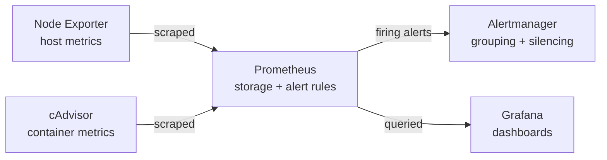
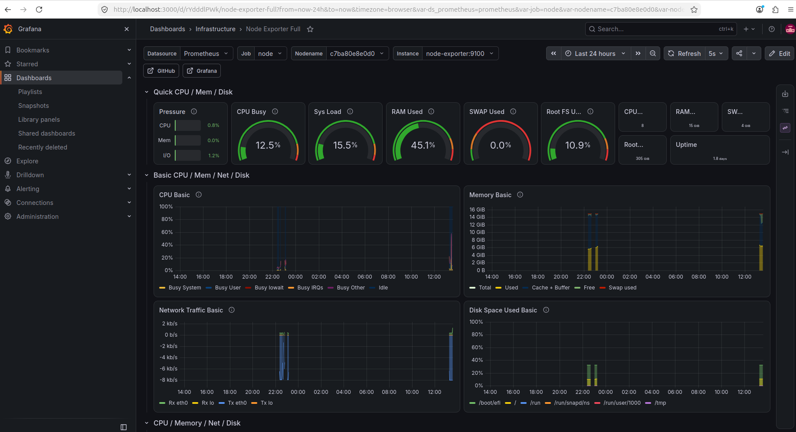
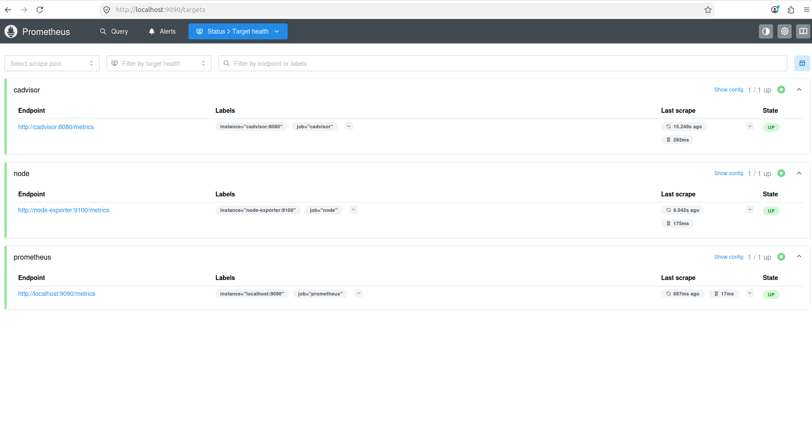
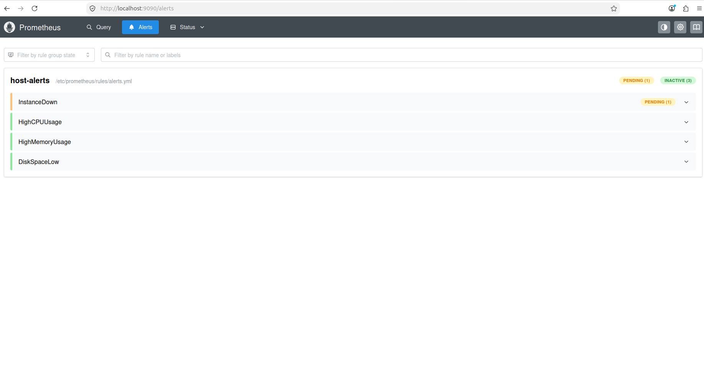

# Infrastructure Monitoring & Alerting Platform

A containerised monitoring stack for Linux hosts and Docker containers, started with a single command. It collects host and container metrics, evaluates alert rules, and shows everything on a pre-provisioned Grafana dashboard.

## Architecture



| Component | Role | Port |
|-----------|------|------|
| Prometheus | Scrapes metrics every 15s, stores 15 days of data, evaluates alert rules | 9090 |
| Node Exporter | Exposes CPU, memory, disk and network metrics of the host | 9100 |
| cAdvisor | Exposes per-container resource usage | 8080 |
| Alertmanager | Receives firing alerts, groups and deduplicates them, supports silences | 9093 |
| Grafana | Dashboards, with datasource and dashboard provisioned from files | 3000 |

## Quick start

Requirements: a Linux host with Docker Engine and the Docker Compose plugin.

```bash
git clone https://github.com/akashpv118-create/monitoring-tool.git
cd monitoring-tool
cp .env.example .env        # then edit .env and set a real Grafana password
docker compose up -d
docker compose ps
```

Then open:

- Grafana: http://localhost:3000 (log in with the credentials from `.env`)
- Prometheus: http://localhost:9090
- Alertmanager: http://localhost:9093

In Prometheus, `Status → Targets` should show all jobs as **UP**.

## Alert rules

Defined in [`prometheus/rules/alerts.yml`](prometheus/rules/alerts.yml).

| Alert | Condition | For | Severity |
|-------|-----------|-----|----------|
| InstanceDown | a scrape target is unreachable | 1m | critical |
| HighCPUUsage | CPU usage above 85% | 5m | warning |
| HighMemoryUsage | memory usage above 90% (based on `MemAvailable`) | 5m | warning |
| DiskSpaceLow | less than 15% free on a real filesystem | 10m | warning |

The `for` duration means a condition must hold continuously before the alert fires, which filters out short spikes.

### Try it

```bash
docker stop node-exporter    # InstanceDown goes pending, then firing after about 1 minute
docker start node-exporter   # it resolves on the next scrape
```

Watch it at http://localhost:9090/alerts and http://localhost:9093.

## Project structure

```
.
├── docker-compose.yml
├── .env.example                  # template for Grafana credentials (copy to .env)
├── prometheus/
│   ├── prometheus.yml            # scrape jobs, alerting target, rule files
│   └── rules/alerts.yml          # alert rules
├── alertmanager/
│   └── alertmanager.yml          # routing configuration
└── grafana/
    ├── provisioning/             # datasource + dashboard provider, loaded at startup
    └── dashboards/               # Node Exporter Full dashboard (JSON)
```

## Notes

- Metrics are most meaningful on a Linux host. On Docker Desktop (macOS/Windows) Node Exporter reports the stats of the Docker VM, not the machine itself.
- `.env` is git-ignored so credentials never reach the repository.
- cAdvisor runs `privileged` to read container stats from the host. Do not expose these ports to untrusted networks.
- Alertmanager has no notification channel configured, so alerts are visible in the UIs only. Adding one (Slack, Discord, email) is a change to `alertmanager/alertmanager.yml`.

## Screenshots

**Grafana: live host metrics from the Node Exporter dashboard**



**Prometheus: all scrape targets up**



**Alert firing after stopping Node Exporter**


